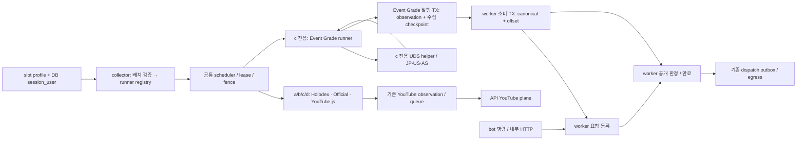
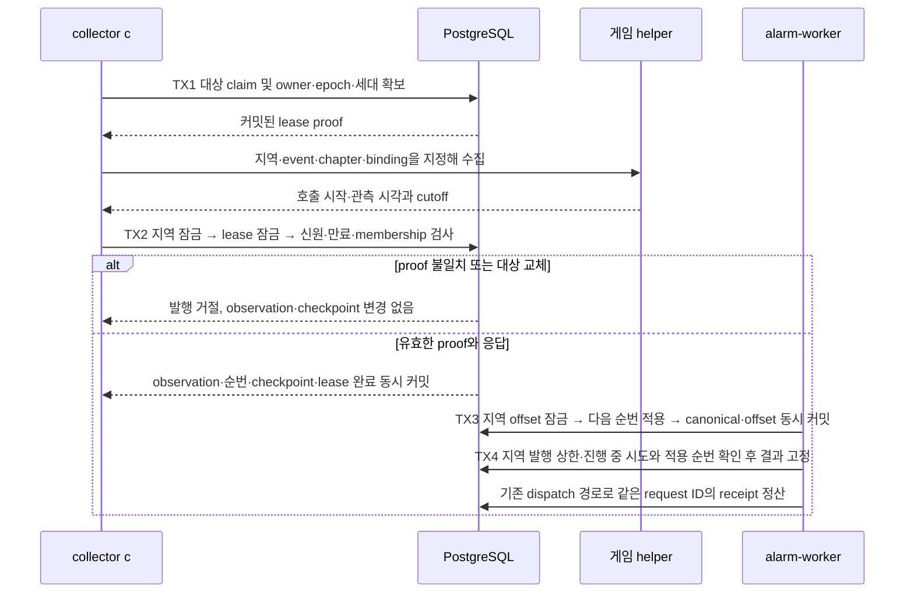

# LIVE: 홀로 — 공통 AP collector와 이벤트 등급 알림 구현 설계

목표는 새 서비스를 추가하지 않고 `hololive-youtube-collector`를 `hololive-collector`로 교체하는 것입니다. 일반화 대상은 **작업 실행과 발행**이지 YouTube 데이터 모델이나 알림 판정이 아닙니다. 아래 내용은 이관 설계이며 운영 배치 현황이 아닙니다. 사용자 접점은 기존 `!이벤트등급`입니다. 별도의 `LIVE` 명령이나 신규 구독 유형을 도입하지 않습니다.

## 소유권과 배치

| 주체 | 할 일 | 하지 않을 일 |
|---|---|---|
| collector a/b/c/d | 기존 Holodex·Official·YouTube.js 작업, lease·checkpoint, 기존 YouTube observation 발행 | YouTube canonical 갱신, 알림 발행 |
| collector c만 | 영구 인증이 설치되고 활성화된 경우에만 JP·US·AS catalog와 cutoff 수집. 한 helper에서 지역 작업 직렬 실행 | 사용자 점수·구독 조회, 판정, 타 AP로 failover |
| hololive-api | 기존 YouTube consume·canonical·알림 intent. bot plane은 등급 명령을 기존 내부 HTTP로 worker에 전달 | Event Grade observation 소비, 명령 처리 중 게임 호출 |
| alarm-worker | Event Grade consume·canonical·요청·판정·기존 dispatch/outbox/egress | 게임 origin 접근, 게임 helper 실행, 게임 인증 파일 열기 |

### 상세 구조도: 의존성 방향

화살표는 호출·데이터 의존성입니다. `W → T`는 등록이 이미 반영된 canonical을 읽는다는 뜻이지, 명령이 수집이나 소비를 동기 호출한다는 뜻이 아닙니다. 게임 provider에서 worker DB 풀·HTTP registrar·dispatch publisher로 가는 의존성은 없습니다.

### 작업 계약과 대상 생성

- 현재 `internal/runtime/collection/job_contract.go`의 `JobID.Provider`, emissions, cadence, roster는 YouTube `pkg/contracts/sourceobservation`에 의존합니다. 공통부는 `(provider, kind, subject)`, 배치 가능한 slot, 실행 예정 시각, 소유 token·fence epoch, 대상 세대, checkpoint, 실행 완료/실패만 압니다. 각 provider가 대상 열거·membership 검증·RPC·결과 검증·발행 SQL을 제공합니다. YouTube projection guard, roster, empty COMPLETE와 기존 observation 형식은 YouTube adapter 안에 보존합니다.
- Event Grade는 지역별 catalog job과 `(region,event_id,chapter_id,marathon_score)` cutoff job을 둡니다. `a/b/d` profile에는 provider 설정·job target·secret mount가 없습니다. `c`의 명시적 활성화와 DB 로그인 `hololive_collector_c`가 모두 필요합니다. 다른 slot의 잘못된 설정은 시작 시 거부하고, DB도 target 열거·claim·publish를 허용하지 않습니다. c의 slot 이름만 흉내 내거나 c가 중단되어도 다른 AP는 호출하지 않습니다. 비활성화가 기본이며, 활성화된 c에서 credential 검증 실패를 빈 성공으로 바꾸지 않습니다.
- 기존 `eventgrade/queries/targets.sql`을 collector로 복사하지 않습니다. 이 SQL은 worker canonical을 읽기 때문입니다. 대신 catalog 발행 트랜잭션이 **수집 전용 대상 checkpoint**를 갱신합니다. 최신 2분 이내 활성 챕터와 `final_after = greatest(event_ends_at,reveals_at)` 이후 24시간 이내의 미확정 대상만 후보가 됩니다. 릴레이의 지난 챕터는 새 catalog에서 사라져도 최종 컷 수집 창까지 보존합니다. 충돌·재할당·공개시각 변경은 대상 세대를 갱신해 이전 lease의 결과를 거부합니다. 기존 분당 지역별 최대 3개 순환과 cursor를 유지하며, collector는 방·사용자·요청 유무를 모릅니다.

### 발행과 소비 계약

- YouTube queue에 게임 payload를 넣지 않습니다. 새 `event_grade_observations`는 append-only이며, 지역별 순번·schema version·kind·관측 시각·job key·scheduled slot·owner/fence·대상 세대를 기록합니다. `catalog` 한 건에 chapters(시작·챕터 종료·이벤트 종료·공개 시각), bindings, conflicts, 중단 후 누락 격리 여부를 함께 담습니다. 별개 행으로 소비해 반쪽 catalog가 보이지 않게 합니다. `cutoff` 한 건은 동일 지역·이벤트·챕터·점수판·binding 세대에 대한 호출 시작/관측 시각, provisional/final 구분, 순위·점수 목록입니다. 원본 응답·인증·사용자 식별자는 저장하지 않습니다.
- RPC 전 lease를 획득하고 catalog 시도 시작을 durable하게 기록합니다. 발행 시 지역 상태를 잠근 뒤 현재 slot·owner token·epoch·만료·대상 세대를 재검사합니다. 유효할 때만 observation append, 지역 순번 증가, 대상/checkpoint 갱신, lease 완료를 같은 트랜잭션으로 커밋합니다. 순번은 지역 잠금 아래에서 배정해 커밋 역전을 막습니다. 동일 논리 실행·동일 내용의 재확인은 기존 발행으로 처리하고, 다른 내용은 충돌입니다. 실패·fence 상실은 마지막 성공 checkpoint를 전진시키지 않습니다. helper의 conflict ACK는 durable catalog 발행 **후**에만 허용합니다. 발행 전 중단은 다음 catalog에서 격리 정보를 잃지 않아야 합니다.
- worker는 지역별 순번대로 읽습니다. `event_grade_consumer_offsets`의 행 잠금, catalog/border 적용, offset 전진을 한 트랜잭션으로 묶습니다. 기존 `Repository`의 검증·binding 충돌 격리·최종 컷 무효화는 소비 경로에서 재사용합니다. 미지원 version·순번 누락은 해당 지역에서 중단하고 다른 지역은 계속 처리합니다. 발행 checkpoint와 소비 offset은 서로 대신할 수 없습니다. 보존 처리는 collector 역할 밖에서 하며, 미소비 행이나 복구에 필요한 행을 삭제하지 않습니다.
- `runner.go`의 수집 루프와 `FinalizeRegions` 호출을 분리합니다. worker 타이머는 c가 내려가도 동작합니다. 지역별 만료 판단 전에 발행과 같은 지역 잠금 아래 이미 커밋된 관측의 상한 순번을 확인하고, 그 순번까지 적용하지 않았으면 판정을 미룹니다. 지연 소비한 기한 내 최종 컷을 `unavailable`로 먼저 고정하지 않습니다. 기한을 걸치는 미완료 cutoff 시도는 그 lease의 유효기간까지 발행/실패가 확정된 후 만료 처리합니다. 기한 뒤에 관측한 응답은 성공 근거가 아닙니다.

### 상세 시퀀스: 한 cutoff의 커밋 경계

TX1과 TX2 사이에는 DB 트랜잭션을 열어 두지 않습니다. 갱신 실패로 소유권을 잃으면 RPC context를 취소하고 뒤늦게 도착한 응답을 버립니다. 발행 시점에도 DB가 proof를 검사하므로 취소 전달 속도에 안전성을 의존하지 않습니다. TX4의 상태 확인과 결과 고정은 같은 지역 잠금 아래 수행합니다. 기존 전 지역 `expire.sql`을 먼저 실행하고 나중에 offset을 확인하는 순서는 사용할 수 없습니다. 외부 발송 성공을 DB 커밋과 동일시하지 않고 기존 outbox receipt 정책을 유지합니다.

## 사용자 계약과 DB 권한

`!이벤트등급 <점수> [jp|us|global]`은 기본 JP, `global`은 AS입니다. 최근 2분 내 유효한 단일 활성 챕터가 없으면 등록하지 않습니다. 기존 `register.sql`처럼 같은 방·사용자·지역·이벤트·챕터·점수판의 재등록은 활성 기간 중 미판정 요청의 점수만 갱신합니다. 첫 등록부터 불변으로 만들지는 않습니다. 마감 후 점수는 고정되며, 공개 기준 이후 **시작한** 호출의 최종 컷만 판정에 사용합니다. 컷 동점은 `boundary`, 초과는 충족한 최고 등급, 미달은 `outside`, 24시간 내 유효한 최종 컷이 없으면 `unavailable`입니다. 판정을 먼저 고정하고 같은 request ID로 기존 outbox receipt를 정산합니다. 재소비가 새 알림을 만들지 않습니다.

collector의 도메인 쓰기는 observation 추가뿐입니다. 별도로 자기 slot의 lease·checkpoint·대상 상태 조작만 허용합니다. Event Grade 테이블에는 c 전용 fenced 발행 연산을 두고 직접 INSERT/UPDATE/DELETE로 검사를 건너뛰지 못하게 합니다. worker는 observation SELECT, 자기 offset 및 기존 `event_grade_catalogs/chapters/borders/requests`와 dispatch 권한만 사용합니다. API YouTube 소비 권한을 게임 테이블까지 넓히지 않습니다. DB role 이름과 기존 YouTube wire 계약은 유지하되, 세션→slot 매핑 및 trigger가 구 실행 이름에 의존하는 `028`·`030`의 계약은 **후속 migration**으로 바꿉니다. 적용 이력 SQL은 수정하지 않습니다.

## 구형 alias·shim 금지: 코드에서 만족해야 하는 조건

**alias**는 구 식별자와 새 식별자가 같은 실행 대상을 선택할 수 있는 상태입니다. **shim**은 구 호출을 받아 새 구현으로 넘기거나, 새 경로 실패 시 구 구현으로 돌아가는 실행 코드입니다. 전환 후 두 경우 모두 금지합니다. 과거 관측에 기록된 문자열을 읽는 것과 그 문자열로 지금 권한을 얻는 것은 다릅니다.

### 이름과 입력의 단일 계약

| 경계 / 현재 코드 | 전환 후 유일한 계약 | 허용하지 않는 동작 |
|---|---|---|
| Go module, `cmd/runtime/youtube-collector/main.go`, `scripts/build/build-youtube-collector-go.sh` | module `github.com/kapu/hololive-collector`, 명령 `cmd/runtime/hololive-collector`, 산출물 `bin/hololive-collector`. 기존 import, 두 workspace의 `use`, Dockerfile·Makefile·CI·dbtest 호출자를 직접 이동 | 구 module 디렉터리, 구 경로를 새 경로로 잇는 `replace`, 구 타입 `type Old = New`, 재수출·전달 함수, 두 번째 `main`, 구 빌드 명령 wrapper |
| `config.WorkerIdentity`, `runtimepolicy.RuntimeYouTubeCollector`, `PostgresCollectorRoleUser` | profile은 `service=hololive`, `role=collector`, worker ID는 기존 `collection`. 런타임 instance는 `collector-a`…`collector-d`의 정확한 네 값, DB 로그인은 기존 `hololive_collector_a`…`_d`와 일대일 | 구 role·instance 수용, prefix 제거·재작성, 알 수 없는 slot을 c로 간주, `PGAPPNAME`만 믿고 인증 |
| `internal/config/{config_env,runtime}.go`, 명령의 로그 경로, unit 환경 | 런타임 `YOUTUBE_COLLECTOR_* → COLLECTOR_*`, 배포 `HOLOLIVE_YOUTUBE_COLLECTOR_* → HOLOLIVE_COLLECTOR_*`, 중지 키 `HOLOLIVE_DISABLE_COLLECTOR`. 예: `COLLECTOR_INSTANCE_ID=collector-c`, `COLLECTOR_RUNTIME_ALLOWED=true`, `COLLECTOR_YOUTUBEJS_REQUEST_TIMEOUT_SECONDS`. 게임 수집 설정은 c의 profile 활성 항목과 `COLLECTOR_EVENT_GRADE_SECRET_FILE`만 사용 | `LookupEnv(new)` 실패 시 old 조회, 신·구 키 우선순위, 구 disable 키만 남아 의도치 않게 활성화. 배포 입력은 허용된 키 목록으로 **치환 전** 검증하여 구 키만 있거나 두 이름이 섞이면 거절. worker에 `EVENT_GRADE_ENABLED/SECRET_FILE` 재주입 금지 |
| Quadlet·native unit, `scripts/deploy/lib/worker-profile-pair.py`, `scripts/deploy/ap-hosts/osaka.conf` | slot별 서비스 식별자는 `collector-<slot>` 하나. c의 예: unit `hololive-collector-c.service`, 컨테이너 `hololive-collector-c`, profile `collector-c.json`, `PGAPPNAME=collector-c`, DNS가 필요하면 `collector-c` 하나. native a의 release 경로·wrapper·checksum·실행 파일 검증도 새 artifact만 선택 | 구 systemd `Alias=`, symlink, 두 이름의 네트워크 alias, 이전 이미지의 새 태깅, 구 profile 파일 탐색, 서비스 인자가 단순 `collector`이면 c로 변환, 신 이미지 누락 시 구 이미지 실행 |

rename은 명칭의 접두어만 바꾸는 작업이 아닙니다. 예를 들어 `worker-profile-pair.py`는 현재 `youtube-collector`를 중앙 c 파일에 대응시키고 a에서는 실제 `/proc` 실행 파일과 release 산출물을 대조합니다. c는 명시적인 `collector-c`만 받고, a의 대조는 새 binary에 대해 **그대로** 수행합니다. `deploy/topology/consumers.tsv`, stack의 `deploy/rhel-host-security/{hololive-seoul,kapu}.conf`, `tools/lint/golangci.template.yml`의 import 경계, 로깅·프로브·설치 inventory도 함께 전환합니다. SELinux 격리나 실행 파일 검증을 완화해서 개명을 통과시키지 않습니다.

### 런타임 분기: 무엇을 지우고 어디에서 거절하는가

1. **registry는 slot별 완전성을 검사합니다.** 현재 `collectorruntime.NewRegistryWithProfiles`는 전체 `collection.InitialJobContracts()`와 runner 집합을 비교합니다. 이를 `expected(slot, enabled providers) == registered JobID set`으로 바꿉니다. 누락·중복·미등록 job·실행 예산 누락은 기동 오류입니다. slot은 기존처럼 instance 환경 설정이 소유하고 profile은 provider 활성 여부를 지정합니다. 실제 DB 로그인에 대응하는 slot이 설정과 일치하는지 확인한 뒤 provider를 조립합니다. a/b/d에서는 게임 factory를 호출하지 않습니다. a/b/d에 게임 설정이 있거나 c가 활성인데 credential 검증에 실패하면 helper 시작 전 오류입니다. 빈 runner·가짜 성공·전 슬롯 game job을 만든 뒤 `Run`에서 skip하는 방법은 금지합니다.
2. **provider-neutral은 타입 별칭이 아닙니다.** 현재 `collection.RunInput`은 `sourceobservation.LeaseProof`, `ContractSnapshot`과 `TargetSnapshot`에, `RunOutput`은 `[]sourceobservation.Envelope`에 결합되어 있습니다. 공통 scheduler는 job identity·실행 기한·fence·종료 결과만 취급합니다. YouTube runner에서만 roster/generation/envelope 검증과 기존 publish를 수행합니다. 게임 runner는 catalog/cutoff 전용 타입과 전용 발행 연산을 사용합니다. `sourceobservation.Provider`에 게임 값을 넣어 YouTube validator를 느슨하게 하거나, 빈 roster·가짜 YouTube envelope로 공통 함수를 통과시키지 않습니다.
3. **worker에는 registrar와 consumer가 하나씩만 있습니다.** `workerapp/build_runtime.go`에는 `appConfig.EventGradeSecretFile != ""` 조건이 두 곳 있습니다. 하나는 `buildEventGradeRunner → OpenHelper`, 다른 하나는 HTTP registrar 선택입니다. **둘 다 제거**합니다. `EventGradeSecretFile`, `loadEventGradeConfig`, 게임 helper cleanup과 `httpapi.NewUnavailableEventGradeRegistrar`를 퇴역시키고 기존 `RegisterEventGrade` repository를 직접 주입합니다. 수집용 `Runner.Start`를 감싸지 말고 consume/finalize 루프를 등록합니다. 깨진 JSON은 기존 400, 최신 단일 활성 챕터가 없으면 정상 응답 `unavailable`, DB 오류는 기존 503입니다. c 장애를 이유로 worker가 RPC를 대신 호출하거나 DB 오류를 `unavailable` 성공으로 바꾸지 않습니다.
4. **DB는 이름이 아닌 실제 세션과 현재 소유 증명을 검사합니다.** 후속 migration에서 `youtube_collector_session_instance()`를 중립 이름 `collector_session_instance()`로 교체하고 이를 쓰는 trigger를 같은 트랜잭션에서 새 함수로 연결한 뒤 구 함수를 삭제합니다. wrapper 함수·구 이름의 view·동시 쓰기 trigger를 남기지 않습니다. `030`의 `owner_instance=<instance>:<token>` 방식은 유지합니다. 새 발행은 `session_user`의 slot, owner **전체 token**, epoch, job key, scheduled slot, 세대, ACTIVE·미만료 상태가 모두 일치해야 합니다. 게임 발행 연산은 `session_user = hololive_collector_c`만 허용하고 `PUBLIC`·공통 수집 role에는 EXECUTE를 주지 않습니다. 기존 YouTube trigger의 비수집 세션 처리로 게임 발행을 허용하지 않습니다.
5. **이력 보존은 호환 실행이 아닙니다.** 기존 `joblease.BuildJobKey`의 `collector:<provider>:<kind>:<suffix>`와 GLOBAL의 `global` suffix는 slot 이름이 아닙니다. 같은 YouTube 작업의 key·epoch·checkpoint를 초기화하지 않습니다. 과거 `collector_instance`는 발행 당시의 provenance로 그대로 replay하고, 구 owner token을 새 owner로 번역·승계하지 않습니다. 전환 전 진행 중 lease는 종료 또는 만료시킨 뒤 새 token·상향 epoch로 획득합니다. 배포된 migration 원문, migration ledger, 과거 관측, 공개 명령 `global → as`, YouTube 고유 provider 이름과 PO issuer는 구 collector alias가 아닙니다.

## 이관 순서와 인수 조건

1. **데이터 전환 준비.** 신규 observation·소비 offset·수집 상태·ACL migration을 추가합니다. 구 writer 정지 후 migration 주체가 기존 지역별 미종료/최종 대기 챕터, binding 충돌, 중단된 catalog 시도를 수집 checkpoint에 이관합니다. 관측하지 않은 데이터에 observation을 소급 발행하지 않습니다. 기존 YouTube lease key·checkpoint와 Event Grade 요청 ID·고정 결과·미발송 outbox를 보존합니다.
2. **소스 단일 전환.** module·binary·image를 `hololive-collector`로 바꾸고 workspace·import·CI·helper 테스트 경로를 같이 갱신합니다. worker의 `eventgrade/server.mjs`, npm lockfile, Go helper 수명주기와 수집 부분만 collector로 옮깁니다. worker에서 게임 secret 설정·mount를 제거하되 X Spaces 전용 Node helper는 유지합니다. worker 등록·consume·finalizer는 게임 helper 유무와 독립적으로 조립합니다.
3. **배포 단위 전환.** 중앙 c, iris-seoul b, kapu d Quadlet과 Osaka a native systemd, profile·인증 주체 매핑·probe·이미지 빌드·설치 및 제거 스크립트를 새 이름으로 일괄 변경합니다. 포트는 바꾸지 않습니다(a 30005, b 30015, c 30025, d 30015, 각 호스트 기준). YouTube PO issuer는 다른 서비스이므로 개명 대상이 아닙니다. `PROJECT_MAP.md`, `SERVICE_OWNERSHIP.md`, 서비스 문서·runbook에서 worker 소유 게임 수집/credential 교체 절차를 제거하고 c 절차로 옮깁니다. 실제 승인 전에는 배포 baseline에 활성화됐다고 기록하지 않습니다.
4. **승인된 전환 창.** 구 수집기와 worker 게임 호출을 정지하고 진행 중 호출 종료·lease 회수를 확인한 뒤 이관합니다. 새 consumer와 collector를 시작하고 c에서만 게임 수집을 활성화합니다. 구 바이너리·unit·alias·호환 shim·이중 writer는 두지 않습니다. 전환 실패 시 신규 발행을 정지하고 observation/offset/요청/outbox를 보존합니다. 구 worker 재가동으로 이중 판정을 만들지 않습니다. 실제 게임 사용은 기존 서비스 문서의 공급자 수집·재전송 권한 확인과 승인된 c credential 설치가 선행 조건입니다.

인수 검증은 실제 게임 계정 없이 격리 PostgreSQL·로컬 helper fixture로 수행합니다.

- 동일한 YouTube 입력을 a/b/c/d에 주어 기존 observation·API consume 결과가 유지되는지, 실제 slot DB 로그인으로 a/b/d의 게임 target 조회·claim·발행이 거절되고 게임 호출 수가 0인지 확인합니다. c 교체 중 이전 token의 응답도 발행되지 않아야 합니다. 변경한 lease/fence와 outbox 경로는 `verify-hololive-bot-youtube`의 대상입니다.
- catalog 발행 직전·직후 및 소비 commit 직전 재시작, 충돌 binding, 지난 릴레이 챕터, 공개 전 시작해 공개 후 도착한 응답, 기한 내 발행했으나 소비가 24시간 경계를 넘긴 최종 컷, c 전체 중단을 재현합니다. canonical·offset·요청 결과 및 outbox가 어느 경계에서도 모순되지 않아야 합니다.
- 기존 데이터가 있는 migration replay 후 실제 bot 명령→등록/재등록→공개 판정→dispatch 수신까지 검사합니다. 권한은 collector의 canonical/request/outbox 쓰기 및 worker의 observation 변조가 DB에서 거부되는 것으로 검증합니다. 패키지화한 unit/profile은 각 호스트 유형에서 새 이름과 기존 포트로 기동 가능한지 별도로 확인합니다.

**구형 경로 차단 인수 사례** — 이름 grep을 CI 게이트로 추가하지 않습니다. 실제 오작동을 다음 경계에서 확인합니다.

| 재현 입력 | 관측해야 할 결과 |
|---|---|
| 실제 `--check-worker-profile`에 구 role 또는 신·구 혼합 profile 전달. 배포 preflight에 구 disable 키와 새 enable 설정을 함께 전달 | preflight 비정상 종료. systemd 시작·외부 호출 없음. 새 profile만 넣은 동일 artifact는 검사를 통과 |
| a/b/d 로그인에 c instance 값을 주거나 c 게임 설정을 주입. 이어서 해당 DB 로그인으로 게임 발행 연산 직접 호출 | 프로세스는 helper를 열기 전 실패하고, Go 검사를 거치지 않은 DB 호출도 권한 거부. observation·checkpoint 불변 |
| 구 owner가 확보한 lease를 만료시켜 새 c가 재획득한 뒤 구 proof로 publish. 과거 정상 YouTube observation은 API로 replay | 이전 publish는 거절, 새 proof만 성공. 과거 관측은 변조 없이 소비되고 해당 job의 checkpoint 계보가 유지됨 |
| 게임 secret·helper가 없는 worker에서 유효한 catalog를 소비한 뒤 등록, 이어서 stale catalog·DB 장애로 각각 등록 | 첫 요청은 성공. stale은 `unavailable`, DB 장애는 503. 어느 경로도 로컬 helper 생성이나 collector 직접 호출 없음 |
| 격리 호스트에서 구 unit·이미지·profile이 설치된 상태로 전환한 뒤 새 unit의 재시작 및 구 서비스명으로 시작 시도 | 새 이름만 기존 포트에서 준비 완료. 구 서비스는 새 프로세스를 시작하지 못함. 새 artifact를 제거한 실패 사례에서도 구 release로 자동 복귀하지 않음 |
