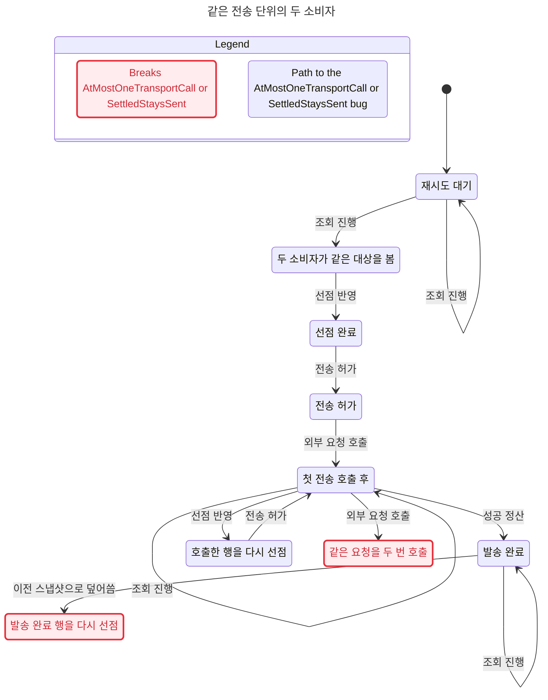

# 알람 발송: 오래된 선점 조회가 완료 행을 되살리는 경합

동기화 커밋: e85f952921e60e2a0f2f183d1e8e65c081f0ffb5

**발견 H1 (저장소 계약 결함, 현재 배포에서는 도달 불가).** 한 소비자가 `ClaimDue`의 조회 스냅샷을 얻고 잠시 멈추면, 다른 소비자가 발송을 성공 정산한 뒤에도 같은 delivery를 다시 `leased`로 바꿀 수 있다. PostgreSQL 18.6의 격리된 실험에서 `sent_at`이 있는 행의 소유자가 B로 바뀌고 B의 발송 진입까지 성공했다. 이는 발송 시도·DB 상태의 결함이지, 같은 메시지가 사용자에게 두 번 표시됐다는 관측은 아니다.

독립 검토 판정: 현재 배포에서는 반증. 중앙 alarm-worker는 하나이고(`docs/current/runbooks/alarm-worker.md`), 활성 `alarm_dispatch`는 worker 1개만 허용되며(`internal/config/worker_profile.go`), 발송 루프는 `DrainBatch → 발송 → markDispatched`를 동기로 끝낸 뒤에만 다음 `ClaimDue`를 호출한다. 따라서 두 소비자가 겹치는 반례는 소비자가 둘 이상일 때만 성립한다. SQL 자체는 단일 소비자를 강제하지 않으므로, 다중 소비자를 허용하려면 send unit 잠금 뒤 멤버의 최신 상태를 다시 확인해 전부 선점하거나 전부 건너뛰어야 한다. 결함 설정은 그 전제가 바뀔 때 다시 확인할 기준으로 남긴다.

| 설정 | 속성 | 검증하는 약속과 피해 |
|---|---|---|
| 기본 | `SendNeedsLiveLease` | 발송 진입 시 `leased`인 행의 현재 소유자이고 미만료여야 한다. 아니면 권한을 잃은 작업자가 외부 발송을 시작한다. |
| 기본 | `SettlementNeedsSendingOwner` | 성공 정산은 현재 `sending` 행의 소유자만 적용한다. 아니면 다른 작업자의 시도를 자신의 결과로 확정한다. |
| 결함 | `SettledStaysSent` | 같은 성공 세대에서 한번 `sent_at`이 기록된 행은 선점으로 `sent`에서 벗어나지 않아야 한다. 아니면 전달 기록과 다음 작업의 판단이 어긋난다. |
| 결함 | `AtMostOneTransportCall` | 오류나 재발급 없이 한 고정 요청을 보낼 때 서로 다른 소비자가 같은 요청으로 두 번 전송 함수를 호출하지 않아야 한다. 아니면 이미 수락됐을 수 있는 요청을 또 제출한다. |

## 코드와 단계

`D`는 `hololive/hololive-alarm-worker/internal/service/alarm/dispatchoutbox/`, `R`은 `hololive/hololive-alarm-worker/internal/egress/alarmdispatch/`다. `D/repository_integration_test.go`의 `TestPgxRepositoryClaimDue_ConcurrentWorkersClaimDisjointRows`와 `TestPgxRepositoryClaimDue_ConcurrentWorkersKeepOneCanonicalGroupAtomic`은 중복 없는 선점을 명시한다. 동시에 goroutine을 출발시키지만 B의 스냅샷과 행 잠금 사이에서 A의 커밋을 강제하지 않는다.

| 모델 단계 | 실제로 끊을 수 있는 지점 |
|---|---|
| `ClaimSnapshot` | `D/repository_claim.go`의 `PgxRepository.ClaimDue`에서 실행한 `D/queries/claim_due.sql`의 READ COMMITTED 문장 스냅샷 획득. `D/queries/delivery_ready_predicate.sql`로 판정할 한 행의 `retry` 상태를 본다. `D/queries/delivery_ready_snapshot.sql`의 별도 모니터링 조회를 선점 권한으로 쓰는 모델이 아니다. |
| `SampleClaimClock` | 같은 문장의 `clock` CTE가 `clock_timestamp()`를 한 번 평가한다. 읽을 버전을 결정하는 스냅샷과 DB 시각 샘플은 다르다. |
| `LockSendUnit`, `SkipLocked` | 같은 문장의 `locked_units`가 `FOR UPDATE OF u SKIP LOCKED`로 **단위 행**을 잠그거나 건너뛴다. A가 이미 커밋했다면 건너뛸 잠금이 없다. |
| `ClaimDue` | `picked`가 스냅샷에서 본 멤버 ID로 `updated`가 delivery의 상태·소유자·만료를 쓴다. 밖에서 보이는 효과는 한 문장의 커밋이다. 외부 UPDATE의 대상 행에는 `WHERE d.id = picked.id`만 있고 최신 대상 상태에 대한 `pending/retry` 재검사가 없다. |
| `BeginSendRequest` | `D/consumer.go`의 `MarkSending` → `D/send_request.go`의 `BeginSendRequest` → `D/queries/send_request_begin.sql`. 단위와 멤버를 잠근 뒤 DB 시각으로 전원을 검사하고 `sending`으로 바꾼다. 모델에서는 요청 ID·멤버·attempt가 고정되어 그 비교는 항상 참이다. |
| `SendPinnedRequest` | `R/alarm_dispatch_runner.go`의 `dispatchPreparedMessageGroup` → `sendPreparedRequest` → `sender.SendPreparedMessage`. 발송 진입이나 그 뒤의 DB 정산과는 별개인 외부 호출 지점이다. 취소되지 않고 성공으로 돌아오는 경로만 택한다. |
| `MarkSent` | `D/consumer.go`의 `MarkDispatched` → `D/repository_transitions.go`의 `PgxRepository.MarkSent` → `D/queries/mark_sent.sql`. 현재 `sending`이고 소유자·attempt·멤버가 일치해야 한다. 이미 성공한 외부 호출의 정산이므로 만료 여부는 검사하지 않는다. |
| `RecoverExpiredLeased`, `QuarantineStaleSending`, `ClockTick` | `D/consumer.go`의 `maybeRecover`, `D/queries/{recover_expired_leased,quarantine_stale_sending}.sql`: `leased`는 `expires_at < now`에 retry로, 오래된 `sending`은 결과 불명으로 격리한다. 단위 잠금이 없는 격리와 단위 잠금이 필요한 회수를 구분한다. 시계는 이산적으로 진행한다. |

## 같은 반례를 코드와 DB에서 따라가기

1. 고정 본문·방·요청 ID·멤버 1개를 가진 단위가 `retry`이며 지금 due다. A와 B의 `ClaimDue`가 이 행을 볼 수 있는 스냅샷을 얻는다. B는 단위 행을 잠그기 전에 멈춘다.
2. A가 단위를 잠그고 `leased`로 선점한 뒤 커밋한다. `prepareGroupRequest`는 고정 요청을 읽는다. `send_request_members.sql`의 종단 판정은 `status`를 보며 `sent_at`의 존재를 검사하지 않는다. A의 `BeginSendRequest`가 `sending`으로 바뀐다.
3. A가 고정 ID로 `SendPreparedMessage`를 호출한다. 수락 뒤 `MarkSent`가 `sent_at`을 기록하고 잠금을 비운다. B는 그동안 실행을 재개하지 않아도 된다.
4. B가 단위 잠금을 얻는다. `SKIP LOCKED`는 현재 잠금만 검사하며 스냅샷을 갱신하지 않는다. B의 `picked`는 여전히 예전 `retry` 버전을 보고, 외부 UPDATE는 같은 ID의 최신 행에 `leased`를 쓴다. **`SettledStaysSent` 위반**이다. 상태 모양 CHECK도 `leased`에 과거 `sent_at`이 남는 것을 금지하지 않는다.
5. 이제 현재 행은 B가 소유한 `leased`다. 방·멤버·attempt·ID는 여전히 일치하므로 B도 `BeginSendRequest`와 외부 호출로 갈 수 있다. TLC의 **`AtMostOneTransportCall` 최단 반례**는 3번의 정산조차 기다리지 않는다. A 호출 직후 B가 `sending`을 덮고 다시 전송 허가를 받는다. `client_request_id`는 동일하므로 Iris의 중복 제거와 최종 방 도착 횟수는 별도 문제다.

재생에는 네트워크가 없는 일회용 PostgreSQL 18.6을 사용했다. 기준 커밋의 두 테이블 정의·CHECK·기본키, 조립한 `claim_due.sql`, `send_request_begin.sql`, `mark_sent.sql`을 사용했다. B 세션에만 같은 이름의 시계 함수를 먼저 찾게 해 문장 스냅샷 **뒤**, 첫 시계 샘플 **앞**에서 테스트용 advisory lock으로 멈춘 뒤 실제 `pg_catalog.clock_timestamp()`를 반환했다. 제품 SELECT/UPDATE 조건은 바꾸지 않았다. A의 선점·발송 진입·정산 성공 뒤 `id=1, status=sent, locked_by=NULL, sent_at IS NOT NULL=true`, B 재개 뒤 `1, leased, B, true`, 그 다음 B 발송 진입 결과 `applied=true`를 확인했다. 외부 호출은 하지 않았고, 5번의 전송 함수 도달성은 Go 분기와 TLC로 확인했다. 실험 컨테이너는 제거했다.

## 실행과 음성 대조

```sh
m=verification/tla/AlarmDispatchClaim/AlarmDispatchClaim
TLC_WORKERS=2 bash /home/kapu/work/iris-stack/tools/lint/verify-tools.sh tlc "$m.tla" "$m.cfg"
TLC_WORKERS=2 bash /home/kapu/work/iris-stack/tools/lint/verify-tools.sh tlc "$m.tla" "${m}Bug.cfg"
```

고정 `tla2tools` 1.7.4 배포본(TLC 배너 2.19), 기본 설정은 종료 0, 서로 다른 상태 977개, TLC 표시 1초 미만이었다. 결함 설정은 종료 12, `SettledStaysSent` 위반이었다. 원본 모델을 그대로 두고 결함 속성을 하나씩 켠 복사본도 각각 종료 12였다. 아래는 별도로 각 SQL 변형을 모델의 대응 단계에 옮겨 얻은 결과다.

| 속성 | 잘못된 변형 | 관찰한 결과 |
|---|---|---|
| `SendNeedsLiveLease` | `send_request_begin.sql`에서 전원 검사 중 `other.lease_valid`만 제거 | 종료 12. 선점 시계 샘플 뒤 시간이 지나 만료 시각에 도달했는데 `sending`에 진입했다. |
| `SettlementNeedsSendingOwner` | `mark_sent.sql` UPDATE에서 `checked.owner_matches` 제거 | 종료 12. B가 다시 선점하고 `sending`에 진입한 뒤 A의 옛 요청이 B 대신 정산됐다. |
| `SettledStaysSent` | 후보·멤버 수·`picked`에서 `status IN ('pending','retry')`를 제거하고, B 시작을 A의 정산 뒤로 제한 | 종료 12. 동시 스냅샷조차 없이 `sent`가 다시 `leased`가 됐다. |
| `AtMostOneTransportCall` | 같은 순차 변형에서 외부 호출 수를 검사 | 종료 12. 완료 뒤에야 시작한 B가 두 번째 호출에 도달했다. |

## 범위와 해석

단위 1개, 멤버 1개, 서로 다른 소비자 2명이며 각자 한 번만 `ClaimDue`를 호출한다. 요청·방·attempt·멤버십은 고정하고 `next_attempt_at`은 처음부터 due다. DB 시각 0~2, TTL과 격리 간격은 각각 1틱이다. 같은 요청과 소유자의 읽기만 수행하는 준비 단계는 발송 진입 직전 성공하는 경우로 투영했다. 단위 행을 선점한 구간을 별도 모델링하며, 나머지 쓰기는 최종 조건 검사·갱신 효과로 표현한다. 읽기 fence 미스·시간 초과·프로세스 중단의 무변화는 대기로도 표현할 수 있다. 이 모델은 모든 PostgreSQL 실행 계획이나 고립 수준의 시뮬레이터가 아니다.

`sent`는 Iris 요청 수락 정산이지 방 도착 확인이 아니다. `sending` 도중 중단하면 격리할 수 있으므로 무조건적인 최소 한 번 전달도 약속하지 않는다. 여러 멤버의 부분 성공, 재발급·handoff, 사용자에게 보인 메시지 수와 공급자 멱등성은 검증하지 않았다. 특히 `internal/egress/youtubedispatch/store/queries/{transition_claim_pending,delivery_ready_predicate}.sql`은 다른 `youtube_notification_delivery` 테이블의 `row_version`·상태 판정·delivery 자체 행 잠금을 사용하는 별도 경로다. 이 발견이나 통과 결과를 그 코드에 일반화하면 안 된다.

## 결함 경로 상태도

`statechart`의 기본 설정은 500상태 예산을 넘어 전체 그림이 없다. 같은 경계의 결함 설정에서 얻은 아래 그림은 두 최단 반례만 그린다. 완료 행의 재선점이 `SettledStaysSent`(11단계), 두 번째 외부 호출이 `AtMostOneTransportCall`(12단계)의 위반이다. 정상 회수·격리 경로는 반례가 아니므로 나타나지 않는다.


