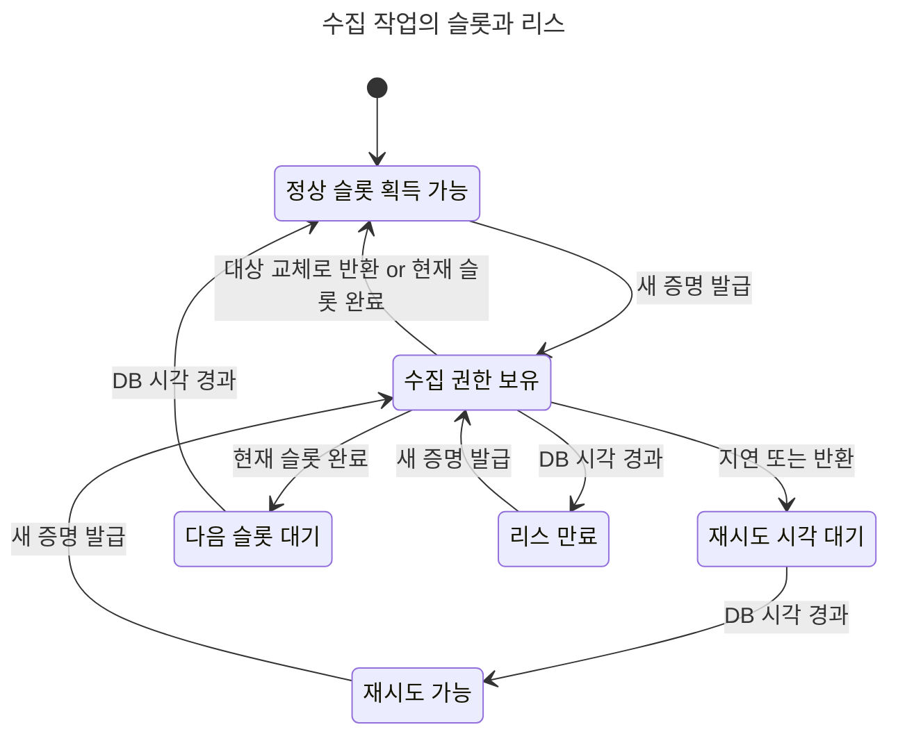

# YouTube 수집 작업: 같은 슬롯을 다시 시작해도 되는 때

동기화 커밋: e85f952921e60e2a0f2f183d1e8e65c081f0ffb5

여러 AP가 하나의 `job_key`를 순회한다. 작업을 빼앗긴 AP가 뒤늦게 반환하거나 같은 인스턴스 이름으로 재획득할 수 있으므로, 작업자의 이름과 현재 실행 권한은 같지 않다. 이 검사는 실제 네트워크 호출 수가 아니라 **DB가 인정한 권한과 슬롯 완료 경계**를 검사한다.

| 속성 | 검증하는 약속 | 깨질 때의 피해 |
|---|---|---|
| `NoEarlyGrant` | 기존 ACTIVE 리스가 만료되거나 DEFERRED의 재시도 시각에 도달하기 전에는 같은 작업을 획득할 수 없다. | 다른 AP의 유효한 수집 또는 공급자 쿨다운을 침범한다. |
| `OnlyCurrentUnexpiredProofWrites` | 갱신·완료·지연·반환은 마지막으로 발급된 증명으로 만료 전에만 성공한다. | 늦게 도착한 과거 실행의 결과가 현재 소유자의 리스를 바꾼다. |
| `CompletedSlotsStayClosed` | 획득한 ACTIVE 슬롯의 `scheduled_for`는 마지막 완료 슬롯보다 반드시 뒤다. | 성공 처리한 슬롯의 수집을 다시 시작한다. |

## 코드와 원자적 단계

경로 기준: `hololive/hololive-youtube-collector/internal/runtime/joblease/`. 한 행의 성공한 전이만 관찰한다. `Acquire`, `Renew`, `CompleteCurrent`에서 표현한 효과는 트랜잭션이 보유한 행 잠금 아래의 최종 갱신이다. 그 앞의 SQL을 서로 독립적으로 재정렬하거나 외부 콜백까지 같은 단계로 취급하지 않는다.

| 단계 | 원본 |
|---|---|
| `Acquire` | `repository.go`의 `Repository.Acquire` → `acquireTx` → `acquireLeaseProof`, `queries/repository_lease_acquire.sql.tpl`의 기존 행 `candidate`/`updated`. 잠기지 않은 due 행만 획득하며 epoch을 증가시킨다. IDLE은 현재 시각을 실효 due 기준의 `date_bin`으로 내림한다. 만료·지연 재획득은 기존 슬롯을 보존한다. |
| `Renew` | `repository.go`의 `JobLease.renewTx`, `queries/{lock_active_lease,lease_membership_query,renew_tx}.sql`. 행 잠금 뒤 최종 `lease_expires_at > clock.now_at` 판정과 TTL 연장이다. |
| `CompleteCurrent` | `repository_complete.go`의 `completeCurrentTx`/`CompleteLease`, `queries/complete_current_lease.sql`. 소유권을 비우고 `scheduled_for + poll_interval`로 정상 슬롯을 전진시킨다. |
| `Defer` | `repository.go`의 `DeferLease`와 `queries/defer.sql`. 잠긴 행의 DB 시각으로 만료를 검사하고 DEFERRED 및 `retry_not_before`를 기록한다. 여기서는 유효한 입력이 2틱 뒤를 선택한다. |
| `Release` | `repository.go`의 `JobLease.Release`, `queries/release.sql`. 보통 반환은 1틱으로 고정한 jitter를 적용한다. |
| `ReleaseSuperseded` | 같은 메서드의 별도 문장 `queries/repository_lease_release_superseded.sql`. 지연을 두지 않고 IDLE로 돌리되 완료로 기록하지 않는다. |
| `ClockTick` | DB 시각이 한 단위 흐른다. 정확히 만료된 시각에는 갱신·종료는 거부하고 획득은 허용한다. 실패한 시도, 잠금 건너뛰기, 롤백은 행에 효과가 없다. |

`proofs`는 삭제하지 않은 이전 호출 인자로, 각 전이에서 과거 증명도 선택할 수 있다. `completedThrough`, `earlyGrant`, `staleWrite`는 검사기 관찰값이다. 발급 순서로 오래된 증명을 판정하므로 실제 epoch 비교식을 검사기에 그대로 복사한 것이 아니다.

## 실행과 반증

저장소 루트에서 실행한다. 고정 `tla2tools` 1.7.4 배포본(TLC 배너 2.19), 작업자 2개로 종료 0, 서로 다른 상태 2,243개, 깊이 11, TLC 표시 1초 미만이었다.

```sh
TLC_WORKERS=2 bash /home/kapu/work/iris-stack/tools/lint/verify-tools.sh tlc verification/tla/CollectionJobLease/CollectionJobLease.tla
```

아래는 임시 디렉터리에서 해당 SQL 변경을 모델 복사본의 같은 단계에 옮기고 해당 불변식 하나로 검사한 결과다. 제품 SQL이나 기본 설정을 변경하지 않았다.

| 속성 | 잘못된 변형 | 관찰한 결과 |
|---|---|---|
| `NoEarlyGrant` | 획득의 DEFERRED 분기에서 `retry_not_before <= now` 제거 | 종료 12. 시각 0에서 Defer가 2까지 미뤘는데 같은 시각에 새 epoch을 발급했다. |
| `OnlyCurrentUnexpiredProofWrites` | 보통 `Release`만 `fence_epoch = $3` 검사 제거 | 종료 12. 대상 교체 반환 뒤 같은 소유자가 같은 슬롯을 epoch 3으로 재획득했고, epoch 2의 반환이 새 리스를 DEFERRED로 바꿨다. |
| `OnlyCurrentUnexpiredProofWrites` | 보통 `Release`만 만료 비교를 `>`에서 `>=`로 변경 | 종료 12. 시각 0에 받은 리스를 만료 시각 2에 반환했다. |
| `CompletedSlotsStayClosed` | 완료 시 `next_due_at`을 다음 주기 대신 현재 `scheduled_for`로 기록 | 종료 12. 시각 0에 완료한 슬롯을 곧바로 다시 획득했다. |

## 범위

기존 IDLE 행 1개와 직전에 완료한 슬롯 하나에서 시작한다. 소유자 2명, 추가 발급 3회 이하, DB 시각 0~4, 고정 주기·TTL 각 2틱이다. 한 틱은 이산화한 시간이지 실제 설정값이 아니다. `job_key`·발급 projection generation은 고정하고 입력·admission·해당 작업이 요구하는 membership 검사가 통과하는 경로만 택한다. 대상 교체 반환은 반환 SQL의 입력으로 다루며, 교체 이유 자체는 검증하지 않는다. 기존 행의 권한 변경은 행 잠금으로 직렬화하고 시간 경과는 허용하지만, 개별 SQL의 실행 계획·잠금 대기 시간이나 시계 역행은 모델링하지 않는다.

최초 INSERT 경쟁, 행 삭제·재생성, 주기/대상 변경, 신규 세대의 membership 판정, 오류 진단·재시도 시각 산식의 전체 입력, publish 트랜잭션·체크포인트·스케줄러·실제 Go 콜백은 범위 밖이다. 만료 후 `scheduled_for`를 유지한 재획득은 의도한 동작이다. 물리적으로 이전 콜백이 아직 실행 중일 수 있으므로 외부 API 폴링이 절대 겹치지 않는다거나 결국 성공한다는 증명이 아니다.

## 상태도

`statechart`의 기본 설정은 500상태 예산을 넘는다. 아래 그림만 `LastTick=2`, `MaxGrants=2`로 줄였다(195상태, 499단계). 같은 표시 상태에 머무르는 갱신 등 257단계는 화살표로 나타나지 않는다. 위 검증 수치는 축소 전 설정이다.


